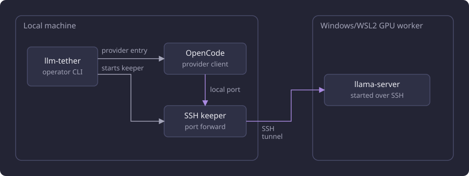

<p align="center">
  
</p>

<p align="center">
  Runs llama.cpp models on a Windows PC with a GPU and makes them available to OpenCode on another machine.
</p>

<p align="center">
  <a href="/LICENSE"></a>
</p>

---

**Contents**

- [Why it exists](#why-it-exists)
- [Features](#features)
- [How it works](#how-it-works)
- [Run your own copy](#run-your-own-copy)
- [Limits](#limits)
- [License](#license)

## Why it exists

I run OpenCode on a VPS and wanted to experiment with models hosted on my own Windows PC, which has
an AMD GPU. The VPS cannot reach a model server on that PC directly, and OpenCode only uses a model
once it is listed as a provider in its config.

This tool does those steps: it starts the model on the PC, connects the two machines over SSH, and
adds the provider to OpenCode. It is for experiments and is not polished.

## Features

### Start and stop models from the VPS

`start` launches a model on the PC and returns once the model answers. The model keeps running after
the command ends. `stop` shuts the model down and removes its provider entry from OpenCode.

### Run several models at once

You can start several copies of one model, or different models side by side. Each one gets its own
port and its own provider entry in OpenCode.

### Subagents for a running model

`create-subagent` writes an OpenCode subagent that uses a running model. The subagents come from the
templates in `templates/`. Stopping the model removes the subagents made for it.

### Checking and repairing

`doctor` checks that the config, OpenCode's files, and the running models agree. `reconcile` and
`clean` fix what `doctor` finds, but they only print what they would change until you add
`--execute`.

## How it works

The tool runs on the VPS, next to OpenCode. It starts `llama-server` on the PC through SSH, and
`llama-server` listens on a port that only the PC can reach. The tool then starts a background SSH
tunnel that forwards that port to the VPS, and adds a provider to OpenCode that points at the
forwarded port.



The tool does not keep running. It records each running model in
`~/.local/state/llm-tether/state.json`, and `stop`, `status` and `reconcile` read that file.

When the last model stops, the tool shuts down the WSL distribution. Reading a large model file
leaves it cached in the WSL virtual machine's memory, and that memory is only released when the
distribution stops.

## Run your own copy

You need:

- Python 3.14 or newer. The tool uses only the standard library.
- SSH access from the VPS to a Windows PC with a WSL2 distribution.
- A llama.cpp build on the PC at `~/.local/src/llama.cpp-<revision>/build/bin/llama-server`, one
  directory per revision.
- The model files (GGUF) on the PC.
- An AMD GPU. The tool sets `HSA_ENABLE_DXG_DETECTION=1` when it starts `llama-server`.
- OpenCode on the VPS.

Steps:

1. Copy the tool directory to the VPS, for example to `~/projects/tools/llm-tether/`.
2. Create the config and fill in the connection and at least one model. The example explains each
   field.

   ```bash
   cp config.toml.example config.toml
   $EDITOR config.toml
   ```

3. Start a model. Leave out `--model` to pick from a menu instead.

   ```bash
   python3 ~/projects/tools/llm-tether start --model <model-key>
   ```

4. Reload OpenCode so it sees the new provider.

   ```bash
   opencode reload
   ```

Other commands:

```bash
python3 ~/projects/tools/llm-tether status
python3 ~/projects/tools/llm-tether logs --model <model-key> --instance 1
python3 ~/projects/tools/llm-tether create-subagent --provider local-<model-key> --template <name>
python3 ~/projects/tools/llm-tether doctor
python3 ~/projects/tools/llm-tether stop --all
```

Run the tool with `--help` for every command and flag. `python3 tests/run.py` runs the tests, which
use a temporary directory and never touch a real config.

## Limits

- This is a personal experiment tool and is not polished. I maintain it only now and then, so
  expect rough edges and slow fixes.
- OpenCode reads its config only on `opencode reload` or `/reload`, so run it after `start`, `stop`
  and `create-subagent`.
- `logs` prints the end of a log once and cannot follow it.
- `restart` gives the model a new provider id, so update anything that used the old one.
- The tool only manages OpenCode providers whose id starts with `local-`.

## License

This project is released under the [MIT License](/LICENSE).
